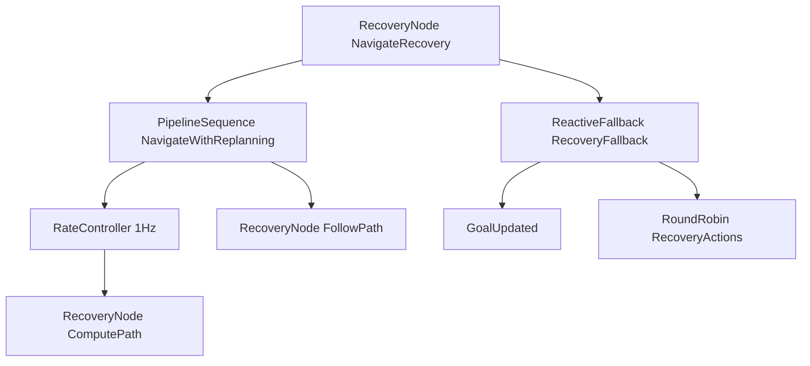

# 周五：读 Nav2 默认导航树

今天不写新逻辑。三份材料都在系统安装目录里。

- 默认树：`/opt/ros/humble/share/nav2_bt_navigator/behavior_trees/navigate_to_pose_w_replanning_and_recovery.xml`
- 动作封装：`/opt/ros/humble/include/nav2_behavior_tree/bt_action_node.hpp`
- 条件插件的形状：`/opt/ros/humble/include/nav2_behavior_tree/plugins/condition/is_battery_low_condition.hpp`
- 控制节点和装饰器的行为以它们自己的头文件注释为准：`recovery_node.hpp`、`pipeline_sequence.hpp`、`rate_controller.hpp`

## 这棵树在干什么

根是 `RecoveryNode`，名字 `NavigateRecovery`，`number_of_retries="6"`。它只有两个孩子：

1. `PipelineSequence` / `NavigateWithReplanning`：能规划并且能跟着走，这条分支就成功
2. `ReactiveFallback` / `RecoveryFallback`：第一条失败时才进来，做恢复

第一条里面，`RateController hz="1.0"` 包着“规划失败就清全局代价地图再规划”。它的兄弟是“跟线失败就清局部代价地图再跟”。

第二条里面，`GoalUpdated` 排在 `RoundRobin` 前面。轮转的恢复动作是：清两张代价地图、转 1.57 弧度、等 5 秒、后退 0.30 米。

## 四个问题

**`PipelineSequence` 和普通 `Sequence` 差在哪里。** 普通 `Sequence` 遇到 `RUNNING` 就停，后面的兄弟本拍不会 tick。`PipelineSequence` 记住已经成功过的孩子：前面的节点即使这一拍又变成 `RUNNING`，后面已经开始过的节点仍然会被 tick。头文件 `pipeline_sequence.hpp` 里的表格写的就是这件事。导航树靠这个，让“规划”和“跟线”叠在一起跑。

**为什么规划大约 1 Hz，跟线每一拍都跑。** `ComputePathToPose` 被 `RateController hz="1.0"` 包着，规划按这个频率 tick。跟线是 `PipelineSequence` 的后一个孩子。规划一旦成功过，后续拍里限速器即使还在等下一秒，跟线仍然继续被 tick。

**恢复分支为什么是 `ReactiveFallback` 加 `GoalUpdated`。** `ReactiveFallback` 每一拍都从第一个孩子重新问。`GoalUpdated` 在目标黑板值变化时返回 `SUCCESS`，于是这一拍不会去 tick 旋转、等待、后退，已经在跑的恢复动作会被打断。这个 `SUCCESS` 对外面的 `RecoveryNode` 来说是“恢复孩子成功了”，导航主分支会重新开始。目标没变时 `GoalUpdated` 返回 `FAILURE`，`RoundRobin` 才执行下一种恢复。

**`number_of_retries="6"` 用尽以后整棵导航返回什么。** `RecoveryNode` 只有第一个孩子成功才返回 `SUCCESS`。导航分支失败就去跑恢复；恢复成功就再试导航。恢复孩子失败，或者重试次数用尽，这个节点返回 `FAILURE`。它就是树根，所以这一次 `NavigateToPose` 失败。

## `BtActionNode` 在一拍里做什么

`ComputePathToPose`、`FollowPath`、`Spin`、`Wait`、`BackUp` 都是 `BtActionNode<ActionT>`。构造时从黑板取出：

- `node`：`rclcpp::Node::SharedPtr`，用来创建 action client
- `bt_loop_duration`
- `server_timeout`
- `wait_for_service_timeout`

`tick()` 在节点还是 `IDLE` 时调用 `on_tick()` 并 `send_new_goal()`。目标还没被服务器确认，或者结果还没到，就 `return BT::NodeStatus::RUNNING`。结果到了才按成功、中止、取消往下走。所以行为树的一拍不会堵在 action 的完成回调上。

XML 里的数据口是另一层：`ComputePathToPose` 读 `{goal}`，写出 `{path}`；`FollowPath` 读 `{path}`。这就是周三的端口重映射，键放在 Nav2 准备好的黑板里。

## 周六要照着抄的形状

`IsBatteryLowCondition` 继承 `BT::ConditionNode`，公开 `tick()` 和静态 `providedPorts()`。Nav2 在对应的 `.cpp` 里用 `BT_REGISTER_NODES` 把类登记成 XML 标签，再编成单独的 `.so`。`BehaviorTreeEngine` 按库名 `dlopen`，不需要把插件编进 `bt_navigator`。周六的 `IsNumberAbove` 就是这个形状，只是条件改成比较两个数。

## 今天的验收

合上笔记，指着默认 XML 能说出：这一拍如果目标没变、路径还有效，tick 会进 `FollowPath`；如果目标刚被换掉、机器人正在 `Spin`，这一拍会从 `GoalUpdated` 成功返回，旋转被打断。不要求把 Nav2 仿真跑起来。
